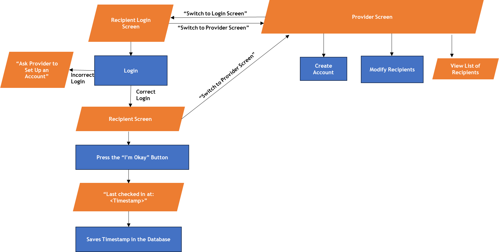
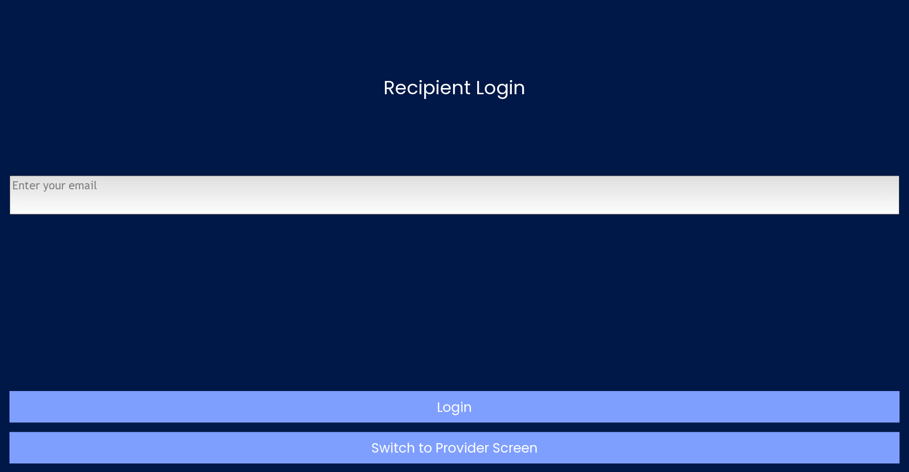
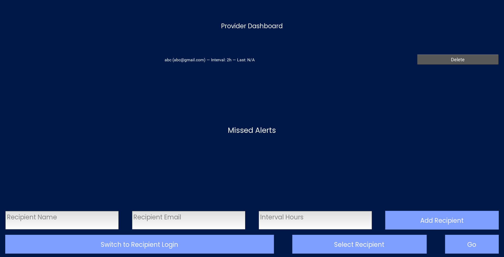
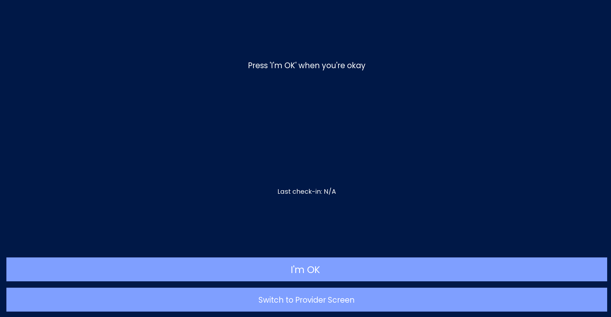
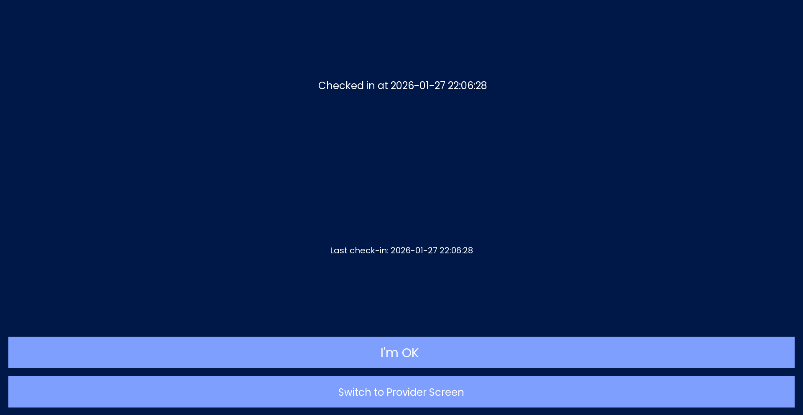
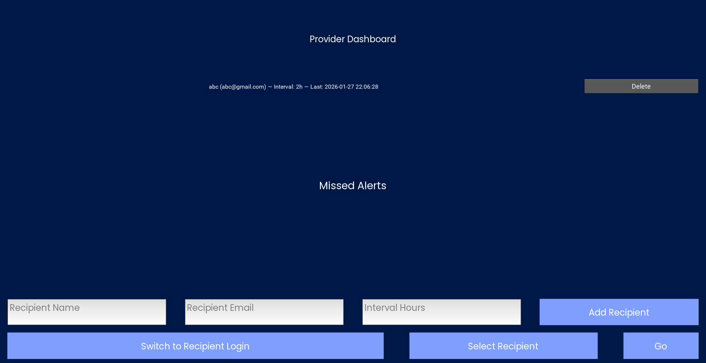
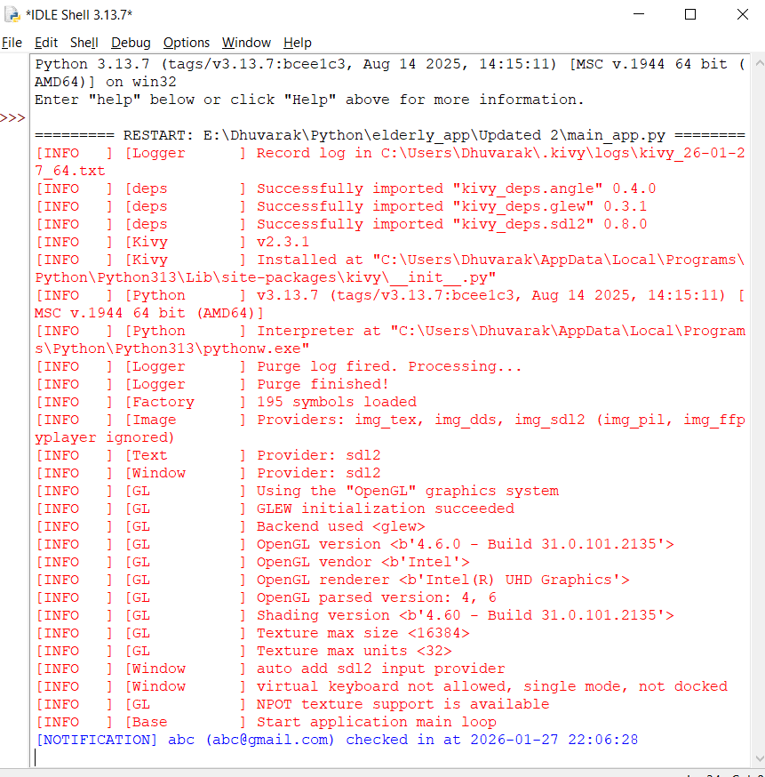

# Beacon — Wellness Check-In App


**Beacon** is a Python/Kivy prototype designed to help caregivers monitor elderly people who may be living independently or with limited supervision. A recipient can check in by pressing **"I'm OK"**, while a provider can register and monitor multiple recipients, view their latest check-ins, and see missed-check-in alerts.

> **Prototype note:** The current version includes buttons that allow switching between the Recipient and Provider screens. This was intentionally included for demonstration and testing, so both sides of the application could be shown without repeatedly logging out and logging back in. A future version would use a single login/authentication flow to determine whether the user is a recipient or provider and display only the appropriate interface.

## Overview

The application has three main screens:

- **Recipient Login** — a recipient enters their registered email.
- **Recipient Screen** — the recipient sees their latest check-in and can press **"I'm OK"**.
- **Provider Dashboard** — a provider can add, view, delete, and select multiple recipients, as well as view missed-check-in alerts.

Check-ins and alerts are stored locally in an SQLite database. The project separates the database layer (`db.py`) from the interface and application logic (`main_app.py`).

## How It Works

```text
Provider adds recipient
        ↓
Name + email + check-in interval
        ↓
SQLite database
        ↓
Recipient enters registered email
        ↓
Recipient presses "I'm OK"
        ↓
Check-in timestamp is saved
        ↓
Reminder is scheduled
        ↓
If the expected interval passes without a check-in
        ↓
"Missed check-in!" alert is stored
        ↓
Provider sees the alert on the dashboard
```

The recipient's check-in is saved with the current date and time. The provider dashboard retrieves the latest check-in for each recipient and lists stored alerts, with the newest alerts displayed first.

The application currently prints a **simulated notification** to the Python console when a recipient checks in. It does not yet send an email, SMS, or operating-system push notification.



## Features

- Recipient login using a registered email address.
- One-tap **"I'm OK"** check-in.
- Persistent storage of check-in timestamps using SQLite.
- Configurable check-in intervals for each recipient.
- Automatic reminder prompts.
- Storage and display of missed-check-in alerts.
- Provider dashboard for monitoring multiple recipients.
- Add and delete recipient records.
- Recipient selection through a provider-side dropdown.
- Local operation without an external server or online database.

## Project Structure & Technologies

```text
beacon-wellness-checkin/
├── main_app.py              # Kivy interface and application logic
├── db.py                    # SQLite database operations
├── requirements.txt         # Python dependency
├── Fonts/                   # Required local font files
├── assets/
│   ├── beacon-logo.png
│   ├── diagrams/
│   │   └── flow-diagram.png
│   └── screenshots/
└── .gitignore
```

The project uses:

- **Python** for the application logic.
- **Kivy** for the graphical interface and screen management.
- **SQLite** through Python's built-in `sqlite3` module for persistent local storage.
- **`datetime`** for timestamps and missed-check-in calculations.

`db.py` creates three tables: `recipients`, `checkins`, and `alerts`. The database file is generated locally as `elderly_app.db` when the application initializes, so it is intentionally excluded from the repository.

### Running the application

1. Install Python.
2. Install Kivy:

```bash
pip install -r requirements.txt
```

3. Place the required licensed font files in `Fonts/`:
   - `Poppins-Regular.ttf`
   - `Trebuchet.ttf`
4. Run:

```bash
python main_app.py
```

On startup, `db.init_db()` creates the required tables if they do not already exist.

## Screenshots

### Recipient Login



### Provider Dashboard

The provider can view recipients and their latest check-in information, add new recipients, delete recipients, and select a recipient to open their screen.



### Recipient Check-In



After pressing **"I'm OK"**, the application records the timestamp and updates the recipient's screen.



The provider dashboard can then display the updated last check-in.



The current notification mechanism is demonstrated in the Python console rather than through a real notification service.



## Limitations & Future Improvements

This version is a **prototype**, so several parts are intentionally simplified for demonstration.

- **Role-based authentication:** The current app allows direct switching between Recipient and Provider screens so both interfaces can be demonstrated easily. A future login system would identify the user's role and show only the relevant screen, making the interface cleaner and closer to a real deployment.

- **Stronger authentication:** Recipient access currently depends on entering a registered email, and there is no password-based authentication. A future version could provide proper credentials and separate provider/recipient authentication.

- **Real notifications:** Check-in notifications are currently simulated with a console `print()` statement. A future version could send actual push, email, or other system notifications to providers.

- **Reminder timing:** The current scheduling code converts the stored interval using `interval_hours * 60`, while missed-check-in detection compares the elapsed time using hours. This should be made consistent in a future version.

- **Mobile support:** The current application is designed as a desktop Kivy application. A future version could be packaged for mobile devices.

- **Expanded care information:** Future versions could allow providers to track additional information such as medication schedules and quiet/sleep hours.

- **Improved interface:** The UI could be refined further for accessibility and easier use by elderly recipients.

## Project Context

Beacon was developed as a Computer Science project to explore how a simple digital check-in system could support elderly people and provide caregivers with timely information about missed check-ins. The current implementation focuses on the core workflow: registration, check-in, reminders, persistent records, and provider monitoring.

The project documentation and screenshots were originally prepared as part of the school project; this repository reorganizes the useful technical information into a concise developer-oriented format.

## Author

**Dhuvarak Sriram Sharma**

School Computer Science Project — 2025–2026
